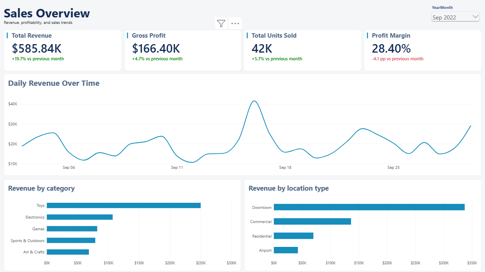
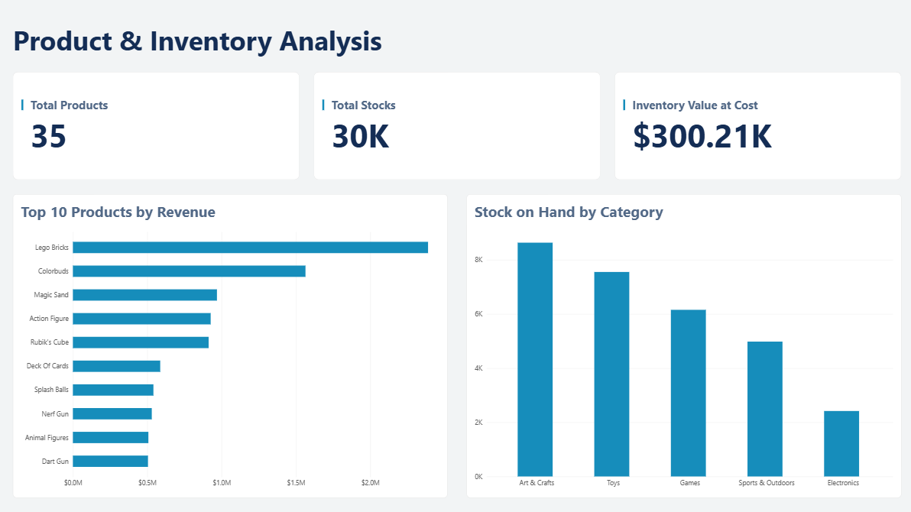
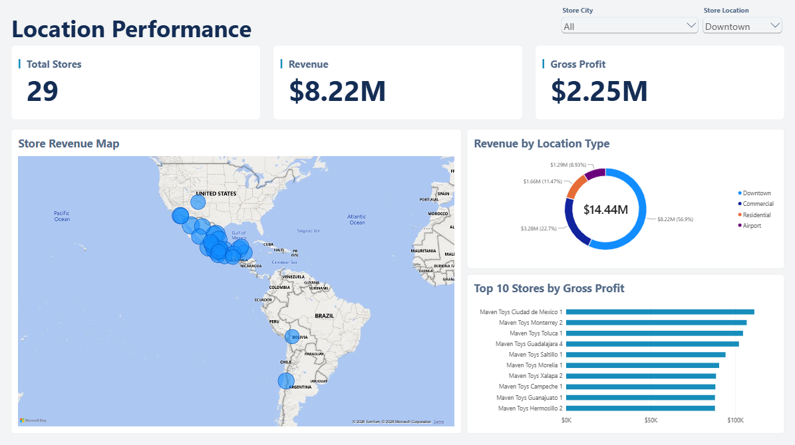

# Mexico Toy Sales Analysis

**Tools:** MySQL · MySQL Workbench · Power BI · Power Query · DAX

## 1. Project Overview

This project analyzes sales, product performance, store performance, and inventory data from the [Mexico Toy Sales dataset](https://mavenanalytics.io/data-playground/mexico-toy-sales) published by Maven Analytics. The dataset represents Maven Toys, a fictitious toy retailer operating in Mexico.

MySQL was used to set up the database, import and validate the data, explore the tables, and perform SQL analysis. Power BI was used to model the data, create DAX measures, and build an interactive dashboard to communicate the findings.

### Project Objective

The objective of this project is to analyze sales performance across stores, months, product categories, and store location types to identify revenue trends and explore potential seasonal patterns. The project also investigates the relationship between product revenue and current inventory levels to identify high-revenue products that may need closer inventory monitoring, as well as products with relatively high stock but low revenue. The findings can help inform decisions about inventory allocation, replenishment, and product performance monitoring.

## 2. Business Questions

### Sales Performance
- How does revenue change over time?
- What are the overall revenue, gross profit, and profit margin?

### Product Performance
- Which products generate the most revenue?
- Which product categories generate the highest gross profit?
- Which products have below-average total units sold?

### Store and Location Performance
- Which stores generate the highest gross profit?
- How does revenue differ across store location types?
- Which cities contribute the most revenue?

### Inventory Analysis
- How much inventory is currently held across all stores?
- Which products have high revenue but relatively low inventory?

## 3. Dataset

**Dataset:** [Mexico Toy Sales — Maven Analytics](https://mavenanalytics.io/data-playground/mexico-toy-sales)  
**Business represented:** Maven Toys, a fictitious chain of toy stores in Mexico  
**Data period:** January 1, 2022 – September 30, 2023

The dataset contains multiple CSV files representing products, stores, calendar dates, inventory, and sales. The following row counts are from the data imported into this project:

| Table | Rows | Description |
|---|---:|---|
| `products` | 35 | Product names, categories, costs, and prices |
| `stores` | 50 | Store names, cities, location types, and opening dates |
| `calendar` | 638 | Unique dates used for time-based analysis |
| `inventory` | 1,593 | Stock on hand for each store-product combination |
| `sales` | 829,262 | Sales records containing date, store, product, and units sold |

A `products_raw` staging table was used to preserve the original product cost and price strings before removing the currency symbol and converting the values to numeric types in the final `products` table.

## 4. Tools and Technologies

- **MySQL:** Database creation, data import, data validation, exploration, joins, aggregations, common table expressions (CTEs), and business analysis.
- **MySQL Workbench:** Database management and SQL execution.
- **Power BI Desktop:** Data modeling and dashboard development.
- **Power Query:** Inspection and preparation of data before loading it into the Power BI model.
- **DAX:** Measures for revenue, cost, gross profit, profit margin, units sold, inventory value, and month-over-month comparisons.

## 5. Database Design

The project uses five main tables:

- `products`
- `stores`
- `sales`
- `inventory`
- `calendar`

The relationships are:

| One-side table | Many-side table | Relationship column |
|---|---|---|
| `products` | `sales` | `Product_ID` |
| `stores` | `sales` | `Store_ID` |
| `calendar` | `sales` | `Date` |
| `products` | `inventory` | `Product_ID` |
| `stores` | `inventory` | `Store_ID` |

The `sales` table contains the sales records, while `inventory` records current stock by store and product. The `products`, `stores`, and `calendar` tables provide descriptive information for analysis.

## 6. Project Workflow

### Phase 1: Database Setup and Import
- Created the `maven_toys` database.
- Defined table structures, data types, primary keys, and foreign keys.
- Imported the CSV data into MySQL.
- Used a raw staging table for product data that required cleaning.

### Phase 2: Data Validation
- Verified row counts and column data types.
- Inspected sample records.
- Checked for duplicate keys and missing values.
- Checked relationships between sales, products, stores, calendar dates, and inventory.

### Phase 3: Data Exploration
- Examined the date range covered by the data.
- Reviewed units sold, product prices, and product costs.
- Investigated product categories and inventory coverage.

### Phase 4: SQL Analysis
- Analyzed revenue over time.
- Compared product and category performance.
- Ranked stores by gross profit.
- Compared revenue across store location types and cities.
- Investigated products with high revenue and relatively low inventory.

### Phase 5: Power BI Development
- Connected Power BI to MySQL using Import mode.
- Inspected and prepared data types in Power Query.
- Created relationships between the five main tables.
- Developed DAX measures and month-over-month comparisons.
- Built a three-page interactive dashboard.

## 7. Power BI Dashboard

The report contains three pages, each designed to answer a different set of questions.

### Page 1: Sales Overview

**Purpose:** Provide an overview of sales performance and profitability.

**KPI cards:**
- Total Revenue
- Gross Profit
- Total Units Sold
- Profit Margin

**Visualizations:**
- Daily Revenue Over Time — line chart
- Revenue by Product Category — bar chart
- Revenue by Store Location Type — bar chart
- Month-over-month comparisons for selected metrics



### Page 2: Product & Inventory Analysis

**Purpose:** Examine product performance and current inventory levels.

**KPI cards:**
- Total Products
- Total Stock on Hand
- Inventory Value at Cost

**Visualizations:**
- Top 10 Products by Revenue — bar chart
- Stock on Hand by Category — column chart



### Page 3: Location Performance

**Purpose:** Compare revenue and profitability across cities, store location types, and individual stores.

**KPI cards:**
- Total Stores
- Total Revenue
- Gross Profit

**Visualizations:**
- Store Revenue by City — map
- Revenue by Store Location Type — donut chart
- Top 10 Stores by Gross Profit — bar chart



## 8. Key Findings and Business Implications

| Finding | Evidence from the data | Business implication |
|---|---|---|
| **Revenue and profitability varied over time, and the Toys category generated the highest revenue among product categories.** | Revenue increased from **$489.42K in August 2022 to $585.84K in September 2022**, a **19.7% increase**. The recorded average month-over-month revenue growth from September 2022 through August 2023 was approximately **5.71%**, although results varied and revenue declined by **20.2% in August 2023**. From May through August, gross profit changed by **−1.7%, +1.6%, -6.8%, and −10.2%**, respectively. Profit margin changed by **−0.1, +0.9, +3.1, and +0.7 percentage points** over those same months. | Compare monthly results by product category to investigate what contributed to changes in revenue, gross profit, and profit margin. The observed pattern may suggest seasonal variation, but the available period is not sufficient to confirm a recurring annual trend. |
| **LEGO Bricks was the highest-revenue-generating product, while inventory levels varied across categories.** | LEGO Bricks generated approximately **$2.4 million in revenue** and had **1,118 units in stock**. Its stock was **331 units lower** than the combined stock of two other top-10 products in the same category. Arts & Crafts had the highest total stock on hand, while Electronics had the lowest; one Electronics product ranked second in revenue among products. | Review inventory for high-revenue products against sales rates and replenishment lead times. The high-revenue Electronics product may warrant closer monitoring, while products with high stock and low revenue may warrant further review. A single inventory snapshot does not establish the correct reorder quantity or prove that a product is overstocked. |
| **Store performance differed across cities, location types, and individual stores.** | Ciudad de Mexico generated the highest city-level revenue and had four stores; Guadalajara and Monterrey also had four stores each and ranked closely behind. The **Downtown** location type generated approximately **$8.22 million in revenue across 29 stores**. At the individual-store level, **Ciudad de Mexico 2** generated the highest gross profit at approximately **$169.86K**. | Compare revenue and gross profit per store, not just totals, because cities and location types have different numbers of stores. Further investigation into high-performing stores may reveal useful patterns, while per-store comparisons can help distinguish store-count effects from individual-store performance. |

## 9. Limitations

- **Gross profit:** Calculated as the difference between total revenue and total cost. It does not account for operating expenses or other costs not included in the dataset.
- **Inventory:** The dataset provides current stock on hand but not historical inventory levels. Inventory changes and historical stockout events therefore cannot be established from this data alone.
- **Sales period:** The available sales data covers January 2022 through September 2023. The period is relatively short for confirming recurring seasonal trends.
- **Inventory recommendations:** Products with high revenue and relatively low stock are candidates for further investigation, but the dataset does not establish reorder thresholds or prove that a stockout will occur.
- **Performance comparisons:** Total revenue and gross profit can be affected by the number of stores in each city or location type. Per-store comparisons provide additional context.

## 10. Repository Structure

```text
mexico_toy_sales_analysis/
├── README.md
├── images/
│   ├── sales_overview.png
│   ├── product_inventory_analysis.png
│   └── location_performance.png
├── powerbi/
│   └── mexico_toy_sales_dashboard.pbix
└── sql/
    ├── 01_database_setup_and_import.sql
    ├── 02_data_validation.sql
    ├── 03_data_exploration.sql
    └── 04_data_analysis.sql
```


## 11. How to Reproduce the Project

1. Install MySQL Server and MySQL Workbench.
2. Download the [Mexico Toy Sales dataset from Maven Analytics](https://mavenanalytics.io/data-playground/mexico-toy-sales).
3. Update the CSV file paths in the SQL setup/import script to match your local folder.
4. Run the setup and import scripts against a fresh database, then run the validation, exploration, and analysis scripts.
5. Open the Power BI report in Power BI Desktop.
6. Configure the MySQL connection for your environment and refresh the imported data if needed.

**Note:** The setup/import script is intended for a fresh database. Do not rerun import commands against an already-populated database without clearing or rebuilding the relevant tables, or duplicate-key errors may occur.

## 12. Conclusion

This project used MySQL and Power BI to analyze Mexico Toy Sales data, covering sales performance, product revenue, inventory levels, and store locations. The analysis identified important patterns, including LEGO Bricks as the highest-revenue-generating product and differences in performance across stores and location types. Through this project, I strengthened my skills in SQL, data validation, data modeling, DAX, and dashboard development while learning how to turn data into meaningful business insights. The findings provide a foundation for further investigation into sales trends and inventory management, while the dataset's limited sales period and lack of historical inventory data constrain conclusions about seasonality and stockout risk.
